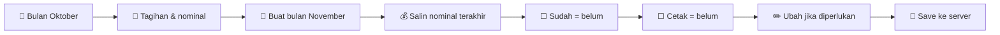
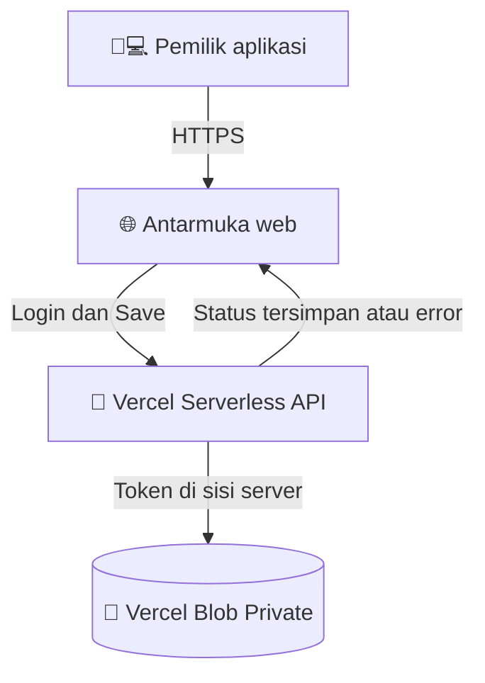

<div align="center">

# 💙⚡ TagihanBulanan

### 🏫📒 Pembukuan Tagihan Bulanan Sekolahan

**⚡ Tagihan listrik · 💧 Air/PAM · ☎️ Telkom · 🌐 Internet · 🛒 Platform pembayaran**

> ✨ **Catat tagihan sekali, lanjutkan otomatis setiap bulan.** Gak perlu bikin sheet baru dari nol!

[](https://tagihanbulanan.vercel.app)
[](https://tagihanbulanan.vercel.app)


### 🌈 Sekilas Tampilannya


*🎨 Gambar di atas adalah **ilustrasi rancangan**, bukan screenshot dari data asli atau bukti fitur server sudah aktif.*

**[🚀 Buka Aplikasi](https://tagihanbulanan.vercel.app)** · **[📖 Dokumen PRD](docs/PRD.md)** · **[🛠️ Setup Deployment](#-deploy-ke-vercel)**

</div>

---

## 🧭 Apa itu TagihanBulanan?

**TagihanBulanan** adalah aplikasi pencatatan **tagihan rutin bulanan** untuk satu pemilik, dibuat berdasarkan kebutuhan workbook `Tagihan Listrik Sekolahan.numbers`. Bukan aplikasi akuntansi penuh, bukan pencatatan laba-rugi, dan bukan aplikasi pembayaran otomatis.

🎯 Fokusnya sederhana: **nominal bulan lalu otomatis dibawa ke bulan baru, tapi status pembayarannya harus dicentang ulang**. Riwayat bulan sebelumnya aman dan tidak ikut berubah.

> 🚦 **STATUS PRODUKSI**: Website berhasil dideploy di Vercel. **Penyimpanan permanen belum aktif** karena Vercel Blob Private belum terhubung (`storageReady: false`). Sebelum tersambung, halaman hanya berfungsi sebagai **pratinjau**, dan Save tidak tersedia. **Jangan memasukkan data pembayaran sungguhan dalam mode pratinjau.**

## 🎁 Fitur utamanya

| Ikon | Fitur | Fungsinya |
|:---:|---|---|
| 📆🔁 | **Pengulangan otomatis** | Tagihan aktif akan muncul lagi pada periode bulan berikutnya. |
| 💰📝 | **Nominal fleksibel** | Nominal sebelumnya menjadi nilai awal. Angkanya tetap bisa diedit. |
| ✅ | **Checkbox “Sudah”** | Menandai pembayaran lunas untuk bulan tersebut. |
| 🖨️✅ | **Checkbox “Cetak”** | Menandai bukti pembayaran sudah dicetak. |
| 🛒 | **Platform bayar / “Toko”** | Catat Shopee, Tokopedia, DANA, atau platform lainnya. |
| 🗂️ | **Kategori dinamis** | Tambah, edit nama, atau arsipkan kategori. |
| ➕➖ | **Baris tagihan** | Tambah dan sembunyikan baris pada bulan yang dipilih. |
| 📊 | **Dashboard ringkasan** | Total, sudah dibayar, belum dibayar, dan bukti belum dicetak. |
| 🕘 | **Riwayat per bulan** | Setiap periode menjadi snapshot yang independen. |
| 💾☁️ | **Save ke server** | Simpan perubahan secara eksplisit saat penyimpanan privat siap. |
| 📥📤 | **Impor / ekspor** | Impor CSV dan ekspor Excel `.xlsx` atau CSV. File Excel bisa dibuka di Apple Numbers. |
| 📱💻 | **Responsif** | Digunakan melalui browser PC maupun HP. |
| 🔐 | **Akses satu pemilik** | Satu akun admin menggunakan password dan sesi cookie aman. |

<div align="center">
  
  <sub>✨ Infografik ilustratif. Angka dan data pada visual bukan catatan transaksi sungguhan.</sub>
</div>

---

## 🔄 Cara kerja tagihan bulanan



**Contoh:** Oktober bayar listrik Rp1.250.000. November otomatis muncul **Rp1.250.000**, tetapi checkbox **Sudah** dan **Cetak** kembali kosong. Saat nominal November diubah, data Oktober tidak ikut berubah. 🧷

## 🖥️ Struktur aplikasi

```text
📁 TagihanBulanan/
├── 📄 README.md              # Dokumentasi utama ini
├── 🌐 public/
│   ├── index.html            # Tampilan web
│   ├── style.css             # Layout PC dan HP
│   ├── app.js                # Interaksi dan editor tagihan
│   ├── model.js              # Aturan tagihan di browser
│   └── export.js             # Ekspor Excel / CSV
├── 🔌 api/
│   ├── health.js             # Status konfigurasi
│   ├── login.js              # Login
│   ├── logout.js             # Logout
│   ├── session.js            # Status sesi
│   └── state.js              # Baca / Save state privat
├── 🧠 lib/
│   ├── model.js              # Validasi dan logika per bulan
│   ├── auth.js               # Password dan sesi admin
│   └── storage.js            # Vercel Blob Private
├── 🖼️ docs/
│   ├── PRD.md                # Kebutuhan dan ketentuan produk
│   └── assets/               # Ilustrasi dokumentasi
├── 🧪 test/                  # Unit test
├── ⚙️ package.json
└── 🚀 vercel.json
```

## 🛡️ Bagaimana data disimpan?



💡 Tombol **Save** hanya menganggap data tersimpan setelah server menyatakan berhasil. Jika ada konflik dari dua tab, operasi penyimpanan ditolak agar catatan tidak tertimpa.

### 🔒 Catatan keamanan

- 🔑 Password **tidak ditulis di source code**.
- 🍪 Sesi memakai cookie `HttpOnly`, `Secure`, dan `SameSite=Strict`.
- 🧱 Data pribadi tidak disimpan sebagai file JSON publik pada repo GitHub.
- 🧹 Project ini merupakan **implementasi baru yang berdiri sendiri**; tidak mengambil kode atau data dari commit aplikasi sebelumnya.
- ⚠️ Blob JSON dipilih untuk tahap MVP satu pengguna. Jika nanti kebutuhan meningkat, migrasi ke database relasional disarankan.

---

## 🚀 Deploy ke Vercel

**Repository:** [`adith92/TagihanBulanan`](https://github.com/adith92/TagihanBulanan)  
**Website:** [**tagihanbulanan.vercel.app**](https://tagihanbulanan.vercel.app)

1. 🔗 Hubungkan repository ke project Vercel `tagihanbulanan`. Production branch = `main`.
2. 📦 Build Command: `npm run build`; Output Directory: `dist`.
3. ☁️ Buka Vercel **Storage**, buat **Blob dengan akses Private**, lalu hubungkan ke project.
4. 🔑 Pastikan variabel server ada: `BLOB_READ_WRITE_TOKEN`, `APP_PASSWORD_SALT`, `APP_PASSWORD_HASH`, dan `SESSION_SECRET`.
5. 🚀 Redeploy Vercel production setelah konfigurasi storage aktif.
6. 🧪 Periksa endpoint `/api/health`: `authReady: true` dan `storageReady: true`.
7. 🧪 **Uji sungguhan**: login → tambah tagihan → Save → refresh → pastikan tagihan masih ada.

> ⚠️ `storageReady: true` hanya menandakan variabel storage ditemukan, **bukan bukti data sudah berhasil tersimpan**. Uji Save dan refresh tetap wajib.

**Membuat password hash di komputer lokal:**

```bash
node -e "const c=require('node:crypto');const salt=c.randomBytes(16).toString('hex'),pass=c.randomBytes(18).toString('base64url');console.log('PASSWORD=',pass);console.log('APP_PASSWORD_SALT=',salt);console.log('APP_PASSWORD_HASH=',c.createHash('sha256').update(salt+':'+pass).digest('hex'));console.log('SESSION_SECRET=',c.randomBytes(32).toString('hex'))"
```

🔐 Simpan password pada password manager. **Jangan commit password, token, atau file `.env.local`.**

## 🗃️ Impor sejarah pembayaran 2020–2026

**Riwayat transaksi adalah data milik pemilik aplikasi dan tidak dipublikasikan di GitHub.** Untuk memigrasikan arsip Numbers, lakukan ekspor menjadi `.csv` lalu gunakan menu **Impor & Ekspor** di aplikasi.

- 📄 Berkas asal: `Tagihan Listrik Sekolahan.numbers`.
- 📥 Impor sekarang mendukung **CSV**. Impor langsung `.numbers` atau `.xlsx` belum tersedia.
- 🗓️ Gunakan kolom `periode` (`YYYY-MM`) apabila satu CSV memuat beberapa bulan. Bila kolom periode tidak ada, pilih bulan tujuan saat import.
- 🧾 Kolom yang didukung: nama/deskripsi, nomor pelanggan, kategori, tagihan, platform/toko, sudah/bayar, cetak, dan periode.
- 🧪 Cek jumlah baris dan nilai rupiah per periode terhadap file sumber sebelum menekan Save.
- 🖨️ Status **Cetak** yang tidak ada di file sumber harus diperiksa manual, bukan ditebak.
- 🔒 Data historis akan tersimpan secara privat **setelah** storage berfungsi dan tombol Save berhasil.

> 📌 **Belum dimigrasikan:** Riwayat di workbook belum tersedia di database live. Kami tidak melakukan impor otomatis dari kode/aplikasi sebelumnya.

## 📊 Format ekspor

| Format | Status | Penggunaan |
|---|---|---|
| 📗 Excel `.xlsx` | ✅ Ekspor tersedia | Buka di Excel, LibreOffice, dan Apple Numbers |
| 📄 CSV `.csv` | ✅ Ekspor dan impor tersedia | Backup sederhana dan pertukaran data |
| 🍏 Numbers `.numbers` | 🔶 Tidak diekspor langsung | Buka file `.xlsx` di aplikasi Numbers |

## 🧪 Developer quick start

```bash
npm install
npm test
npm run lint
npm run build
```

Untuk menjalankan API lokal: instal Vercel CLI, link project yang sesuai, lalu jalankan `vercel dev` setelah memasang environment variables secara aman. Jangan gunakan SQLite di `/tmp` sebagai database Vercel.

## 📡 Endpoint API

| Endpoint | Method | Deskripsi |
|---|---|---|
| `/api/health` | GET | Informasi kesiapan konfigurasi |
| `/api/session` | GET | Status login |
| `/api/login` | POST | Masuk |
| `/api/logout` | POST | Keluar |
| `/api/state` | GET | Baca state privat, perlu login |
| `/api/state` | PUT | Save state privat, perlu login |

---

<div align="center">

### ✨ Satu aplikasi. Semua tagihan. Setiap bulan. ✨

⚡💧☎️🌐🛒🧾💾☁️📊✅📆🗂️🚀

**Dibuat untuk mengurangi pekerjaan berulang, bukan menambah tab spreadsheet.** 💙

</div>
