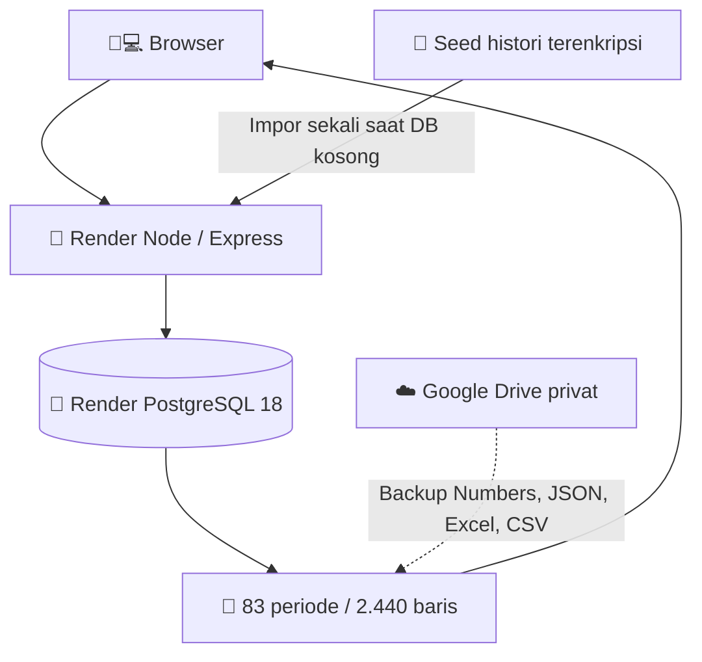

<div align="center">


# 💙⚡ TagihanBulanan
### 🏫📒 Pembukuan Listrik · 💧 Air · ☎️ Telkom · 🌐 Internet

**📅 Semua bulan · 💰 Rupiah · ✅ Status bayar · 🖨️ Bukti cetak · 🚀 Render · 🐘 PostgreSQL**

[🌍 **Buka aplikasi Render**](https://tagihanbulanan.onrender.com) · [🛠️ **Dashboard Render**](https://dashboard.render.com/web/srv-dbeqv45g1s2s73dgohtg) · [📚 **Laporan impor**](docs/IMPORT_REPORT.md) · [📖 **Panduan setup**](RENDER_SETUP.md)

   

</div>

## 🖼️ Tampilan


> 🎨 Gambar adalah ilustrasi desain, **bukan** screenshot sistem live.

## 🧮 Apa yang sudah disiapkan dari Apple Numbers?

| 🧾 Data asli | Jumlah |
|---|---:|
| 📆 Bulan historis | **83** |
| 💳 Baris tagihan | **2.440** |
| 🧍 Master tagihan berulang | **71** |
| 🗂️ Kategori | **6** |
| 🗓️ Rentang waktu | **November 2019 sampai Oktober 2026** |

Data diekstrak dari **Tagihan Listrik Sekolahan.numbers** dan dijadikan *seed* AES-256-GCM yang aman disimpan di GitHub publik. **Tidak ada nama pelanggan atau angka tagihan dalam plaintext di repository.** File `.numbers` asli, JSON, CSV, dan Excel cadangan disimpan di Google Drive pribadi. Februari 2020 tidak ada tab di sumber aslinya.

⚠️ **Status aktual:** Web service dan PostgreSQL Render sudah dibuat, namun data historis belum terverifikasi masuk sampai `DATABASE_URL` diisi, startup impor sukses, dan angka query SQL diverifikasi. Bukan mode demo dan bukan Google Apps Script.

## 🎁 Fitur utama

| Ikon | Fitur | Keterangan |
|:---:|---|---|
| 📅🔁 | **Pengulangan bulanan** | Nominal pelanggan menyalin dari periode terakhir, status bayar/cetak kembali kosong |
| ✅ | **Sudah** | Centang setelah tagihan dibayar |
| 🖨️ | **Cetak** | Centang jika bukti sudah dicetak |
| 🛒 | **Toko** | Platform pembayaran, misalnya Tokopedia, Shopee, DANA |
| ➕➖ | **Baris** | Tambah sekali atau bulanan, sembunyikan per periode |
| 🏷️ | **Kategori** | Tambah, ubah, arsip tanpa menghapus sejarah |
| 💾 | **Save** | Menyimpan ke PostgreSQL, dengan kontrol versi transaksi |
| 📊 | **Dashboard** | Rekap total, lunas, belum lunas, bukti belum dicetak |
| 📜 | **Riwayat** | Setiap bulan menyimpan snapshot sendiri |
| 📤 | **Ekspor** | Excel `.xlsx` / CSV yang dapat dibaca Apple Numbers |
| 📱💻 | **Responsif** | PC dan HP |

## 🐘 Arsitektur Render



**Tidak menggunakan Google Apps Script, Vercel Blob, maupun SQLite.** Data JSON asli disimpan dalam satu transaksi PostgreSQL dan tersedia melalui view SQL `bill_history`, `bill_period_totals`, `bill_categories`, dan `bill_templates`.

### 🔐 Impor aman, otomatis, dan idempoten

`seed/initial.enc` merupakan arsip terenkripsi. Saat startup pertama, `server.mjs` membuka seed hanya jika `INITIAL_SEED_KEY` valid serta koneksi `DATABASE_URL` tersedia. Impor hanya dilakukan jika tabel `tracker_state` masih kosong. Restart atau redeploy tidak menghapus transaksi yang telah diedit.

**Status dan pemeriksaan:**

```bash
curl -s https://tagihanbulanan.onrender.com/api/health
```

Hasil yang diharapkan adalah `storageReady:true`. Verifikasi data lewat SQL:

```sql
SELECT COUNT(*) AS total_tagihan, COUNT(DISTINCT period) AS jumlah_periode FROM bill_history;
-- Harapan: 2440 tagihan, 83 periode
```

## ⚙️ Setup koneksi satu kali

1. 🐘 Database PostgreSQL ada di [Render database](https://dashboard.render.com/d/dpg-dbequp9srm7s73d2g0eg-a).
2. 🚀 Service Node.js ada di [Render web service](https://dashboard.render.com/web/srv-dbeqv45g1s2s73dgohtg).
3. 🔗 Di web service → **Environment**, isi `DATABASE_URL` dengan **Internal Database URL** yang diperoleh di database → **Connect**. Jangan publikasikan URL itu karena berisi password database.
4. 🔑 `INITIAL_SEED_KEY` disetel sebagai variabel privat Render (file referensinya disimpan terpisah di Google Drive pribadi).
5. 🔄 Setelah konfigurasi tersimpan, Render otomatis memulai deploy. Buka `/api/health`, periksa impor SQL, lalu uji **edit → Save → refresh → nilai tetap tersimpan**.

📚 Dokumentasi lengkap: [RENDER_SETUP.md](RENDER_SETUP.md)

## 🔓 Tanpa halaman login, sesuai permintaan pengguna

Aplikasi ini disiapkan tanpa form login. **Perhatian: jika situs dapat dibuka dari internet, siapa pun yang memiliki URL dapat membaca, menyalin, dan mengubah data tagihan pribadi.** Untuk keamanan, batasi akses melalui jaringan pribadi atau gerbang identitas yang mempertahankan sesi agar tidak harus login setiap kali. `noindex` bukan mekanisme keamanan.

## 💸 Ketentuan paket Free

- PostgreSQL Free Render memiliki masa aktif 30 hari dan tidak menyediakan backup otomatis bawaan.
- Instance baru dibuat pada 25 Oktober 2026 dan dilaporkan kedaluwarsa **24 November 2026**.
- Upgrade dan backup wajib dilakukan sebelum database digunakan jangka panjang.

## 🧪 Jalankan lokal

```bash
npm install
# Siapkan DATABASE_URL dan INITIAL_SEED_KEY dalam environment privat.
npm start
```

## 🧭 Struktur proyek

```text
TagihanBulanan/
├── 📜 README.md
├── 🧠 server.mjs               # Express + PostgreSQL + importer awal
├── 🧾 seed/initial.enc         # Encrypted, bukan data publik
├── 🎨 public/                 # UI dan ekspor
├── 📚 docs/                   # Spesifikasi, audit dan ilustrasi
├── 🔧 RENDER_SETUP.md
└── ⚙️ package.json
```

## 📋 Catatan rekonsiliasi

Beberapa subtotal formula file asal tidak sama dengan penjumlahan seluruh sel angka (contohnya Oktober 2026). Aplikasi mengutamakan setiap baris dan menyertakan jejak `sourceSheet`, `sourceRow` untuk audit, tanpa diam-diam menghilangkan tagihan. Lihat [audit impor](docs/IMPORT_REPORT.md).

<div align="center">

---

### 💙⚡ Semua bulan, semua tagihan, satu aplikasi yang rapi.

**🏫 📅 💰 ✅ 🖨️ 📦 🚀 🐘**

</div>
