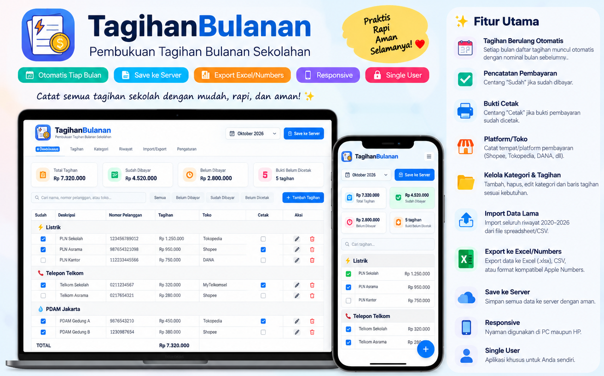
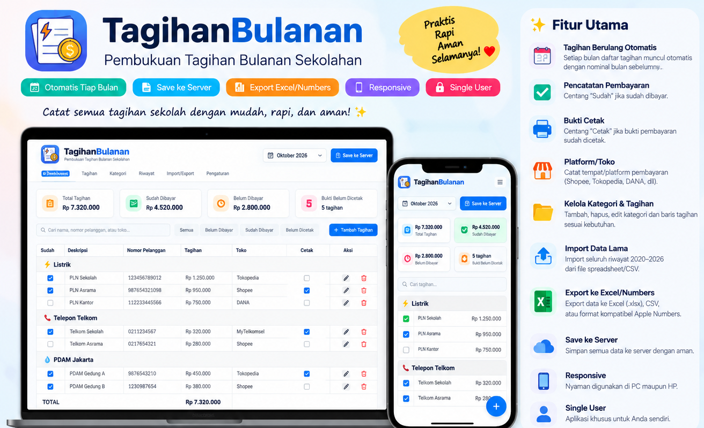
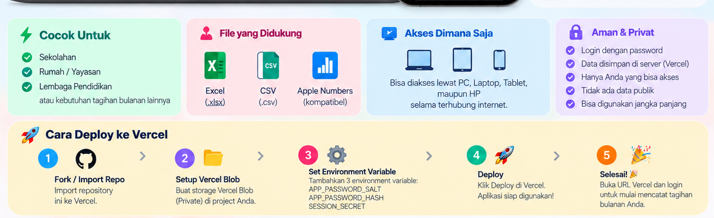
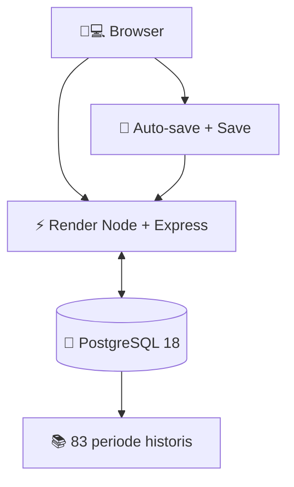

# 💙⚡ TagihanBulanan v4.2.1

### 📅📒 Catatan Bulanan • 🏫🏘️ Tagihan • 💰 Rupiah • 🛒 Pembayaran

[🚀 **BUKA APLIKASI**](https://tagihanbulanan.onrender.com) · [📊 **PERUBAHAN V4.2**](CHANGELOG_v4.2.md) · [📚 **AUDIT IMPOR**](docs/IMPORT_REPORT.md)

  

## ✨ Fitur Favorit

| | Fitur | Cara memakai |
|---|---|---|
| ↔️ | Pindah kolom | Drag judul kolom ke posisi lain (desktop) |
| 📐 | Atur lebar | Tarik sisi kanan header kolom |
| 💰 | Currency IDR | Nilai otomatis tampil sebagai **Rp 1.000.000** |
| ☁️ | Auto-save | Simpan ke Render PostgreSQL setelah selesai mengedit |
| 🔁 | Sinkron ulang | Periksa pembaruan server saat tab aktif |
| 🛒 | Blibli | [Buka pembayaran](https://www.blibli.com/digital/p/top-up-tagihan) |
| 🛍️ | Tokopedia | [Buka pembayaran](https://www.tokopedia.com/top-up-tagihan) |
| 📂 | Riwayat | **83 bulan, 2.440 tagihan, 71 master** diimpor dari Apple Numbers |

> Gambar hanyalah ilustrasi konsep desain, bukan screenshot produksi.

## 🧾 Oktober 2026

Data dari spreadsheet asli menunjukkan September dan Oktober 2026 sama-sama 31 baris dengan total Rp15.928.209. Jika Oktober masih identik dengan September saat deployment, migrasi otomatis mengosongkan status Sudah/Cetak agar pembayaran bulan baru belum dianggap lunas, tanpa mengubah nominal atau riwayat September. Snapshot sebelum koreksi disimpan di database. Jika sebagian Oktober sudah diedit, hanya baris yang masih identik dengan file Numbers asli yang direset; baris yang sudah diubah tetap utuh. Backup kondisi sebelum migrasi tersimpan di database.

Status: [Render health](https://tagihanbulanan.onrender.com/api/health) · `october2026Migration`.

## 🐘 Arsitektur

- Data disimpan di database PostgreSQL, bukan di Google Apps Script, Vercel Blob, atau SQLite.
- Kolom dan lebar tabel disimpan secara lokal di browser pada setiap perangkat.
- Simpanan tagihan memakai revisi database; jika terjadi konflik, perubahan yang belum tersimpan tidak otomatis menimpa transaksi lain.
- Kode backend ada di `server.mjs`, logika migrasi Oktober di `lib/october-migration.js`, dan UI di `public/`.
- `npm install && npm start` untuk menjalankan. Server perlu variabel privat `DATABASE_URL` dan `INITIAL_SEED_KEY` saat impor awal.

## ⚠️ Privasi dan Masa Berlaku

Aplikasi tidak memakai login sesuai permintaan awal pemilik, sehingga **pengunjung yang memiliki URL dapat mengakses atau mengubah informasi tagihan**. Gunakan pengaman akses di depan aplikasi. Database Render Free ini akan berakhir pada **24 November 2026**. Tingkatkan paket atau cadangkan data sebelum berakhir. File Numbers asli dan backup terpisah tersimpan di Google Drive pribadi.

## 📝 Dokumentasi

- [CHANGELOG v4.2](CHANGELOG_v4.2.md)
- [RENDER_SETUP](RENDER_SETUP.md)
- [IMPORT_REPORT](docs/IMPORT_REPORT.md)

💙 📅 ✅ 💰 🖨️ 🛒 ☁️ 🐘 🚀

