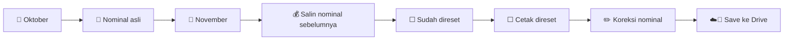
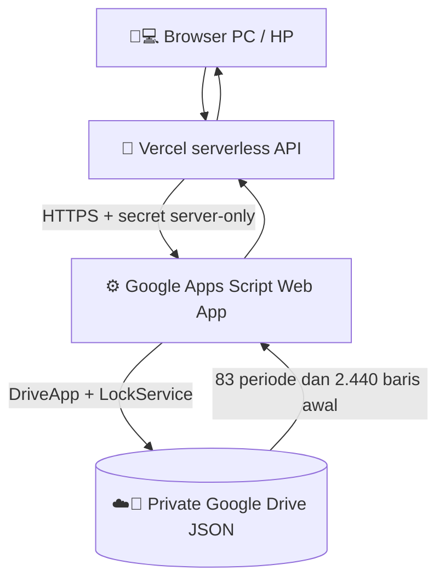

<div align="center">


# ⚡💙 TagihanBulanan
### 🏫 📒 Pembukuan Tagihan Bulanan | PC 💻 & HP 📱

**🔁 Tagihan berulang · 💾 Save ke Google Drive · 📊 Riwayat lengkap · ✅ Status pembayaran · 🖨️ Bukti cetak**

[](https://tagihanbulanan.vercel.app)
[](https://github.com/adith92/TagihanBulanan)
[](#-database-google-drive)
[](https://vercel.com/)

**✨ “Sekali catat, muncul lagi tiap bulan.” ✨**

[🌍 Website](https://tagihanbulanan.vercel.app) • [🎨 Galeri UI](#-tampilan-aplikasi) • [☁️ Koneksi Drive](#-cara-aktifkan-save-ke-google-drive) • [📑 PRD](docs/PRD.md) • [🧾 Audit Import](docs/IMPORT_REPORT.md)

</div>

---

## 🧭 Apa itu TagihanBulanan?

Aplikasi pencatat tagihan rutin satu pengguna yang menggantikan penggunaan banyak tab spreadsheet. Dibuat ulang khusus dari spesifikasi pengguna dan file **`Tagihan Listrik Sekolahan.numbers`**, tanpa mengambil **kode, aset, atau dependensi aplikasi versi lama**.

⚠️ **Status:** Web Vercel sudah tersedia. **Data 2.440 transaksi telah diekstrak dari file Numbers asli dan diimpor ke Google Drive pribadi sebagai JSON, Excel, CSV dan backup asli.** Namun **tombol Save di website baru aktif setelah pemilik menerbitkan Google Apps Script Web App dan mengisi 2 variabel Vercel**. Sampai saat itu, website tetap dalam *mode pratinjau*. Jangan melakukan transaksi nyata dalam mode pratinjau.

## 🎨 Tampilan aplikasi

<p align="center">

</p>

<p align="center">

</p>

> 🖼️ Ketiga gambar adalah **ilustrasi konsep** yang digunakan untuk dokumentasi, bukan screenshot produksi atau bukti koneksi database sudah aktif.

## 🎁 Fitur

| 🎨 | Menu | Detail |
|:---:|---|---|
| 📆🔄 | **Ulang bulan otomatis** | Tagihan muncul lagi dengan nominal terbaru bulan sebelumnya. |
| 💰✏️ | **Edit nominal** | Setiap bulan bebas punya nominal berbeda. |
| ✅ | **Sudah** | Checkbox tagihan telah dibayar. |
| 🖨️ | **Cetak** | Checkbox bukti sudah dicetak. |
| 🛒 | **Toko** | Tempat pembayaran seperti Tokopedia, Shopee, Blibli, DANA. |
| 🏷️ | **Kategori** | Tambah, edit nama, arsipkan. |
| ➕➖ | **Baris** | Tambah baris dan sembunyikan baris pada bulan aktif. |
| 📊📈 | **Dashboard** | Total tagihan, terbayar, belum dibayar, bukti belum dicetak. |
| 📚🕰️ | **Riwayat** | Snapshot per bulan, tidak merusak bulan lama. |
| ☁️💾 | **Save** | Simpan ke file JSON privat di Google Drive melalui Google Apps Script. |
| 📥📤 | **Impor / Ekspor** | Impor CSV, ekspor Excel `.xlsx` dan CSV. Excel bisa dibuka melalui Apple Numbers. |
| 🔐 | **Single-user** | Password dan sesi admin memakai cookie HttpOnly. |
| 📱💻 | **Responsif** | Web untuk PC dan ponsel. |

## 🔁 Logika tagihan tiap bulan



**Contoh:** Listrik Oktober Rp1.250.000 dan sudah dibayar ✅. Pada November muncul Rp1.250.000 lagi, tetapi **Sudah ❌** dan **Cetak ❌**. Semua histori bulan Oktober tetap utuh.

## 🗄️ Database: Google Drive

**Ya, Google Drive bisa dipakai sebagai penyimpanan untuk aplikasi kecil satu pemilik.** File JSON privat di Drive menjadi *source of truth*. Bukan database SQL, tetapi cukup untuk ribuan baris dan pemakaian personal; karena setiap Save menulis satu dokumen utuh, pilihan ini tidak cocok untuk banyak editor bersamaan.



🛡️ **Keamanan:** file tagihan tidak ada di repository publik, hanya Google Drive pribadi; password dan bridge secret disimpan sebagai Vercel Environment Variables + Apps Script Script Properties, bukan ditulis di GitHub. Save punya validasi nomor versi untuk menghindari menimpa perubahan dari tab lain.

### 🔌 Cara aktifkan Save ke Google Drive

Proses setup satu kali oleh pemilik akun Google:

1. 📂 Di Google Drive pribadi, temukan file privat **`tagihanbulanan-state-v3.json`** yang sudah diimpor. Salin **file ID** dari link Drive (bukan seluruh link).
2. ⚙️ Buka [script.google.com](https://script.google.com) → **New project** → tempel seluruh isi [`apps-script/Code.gs`](apps-script/Code.gs). Beri nama `TagihanBulanan Drive Bridge`.
3. 🔑 Pada **Project Settings → Script Properties**, tambahkan:
   - `DATA_FILE_ID` = ID file JSON dari langkah 1.
   - `BRIDGE_SECRET` = token acak panjang minimal 32 karakter, yang disimpan pribadi.
4. 🧪 Jalankan `testDriveConnection` satu kali untuk mengotorisasi akses Google Drive pribadi. Lihat Execution log. Hanya akan membaca metadata, tidak menghapus data.
5. 🚀 **Deploy → New deployment → Web app**. `Execute as: Me`, `Who has access: Anyone`, lalu **Deploy**. Akses anonim ke web app tetap dilindungi shared secret di tiap request. Jangan bagikan secret.
6. 🔐 Di **Vercel → Project Settings → Environment Variables**, isi `GDRIVE_BRIDGE_URL` = URL `/exec` Google Apps Script dan `GDRIVE_BRIDGE_SECRET` = secret yang sama. Target **Production**.
7. 🔄 **Redeploy** production. Endpoint `/api/health` harus menunjukkan `authReady: true` dan `storageReady: true`.
8. ✅ **Uji sungguhan:** login → buka data historis → tambah 1 baris tes → **Save** → refresh browser → pastikan data tetap ada. Hapus baris tes lalu Save lagi.

📌 **Penting:** `storageReady: true` berarti variabel konfigurasi ada, bukan jaminan aplikasi berhasil menulis Drive. Uji Save dan refresh wajib dilakukan.

⚠️ **Google Apps Script perlu diotorisasi langsung oleh pemilik Drive.** Koneksi Google Drive yang tersedia di ChatGPT tidak otomatis memberikan akses server Vercel. Jangan tempel token/credential di issues, PR, atau README.

## 📦 Hasil impor Numbers asli

| Pemeriksaan | Hasil |
|---|---|
| 📂 Nama file asli | `Tagihan Listrik Sekolahan.numbers` |
| 📅 Periode | **November 2019 → Oktober 2026** |
| 📆 Jumlah bulan | **83** (Februari 2020 memang tidak ada tab di file asal) |
| 🧾 Baris tagihan | **2.440** |
| 🗂️ Kategori normalisasi | **6** |
| 📄 Backup Drive | File asli, JSON aplikasi, Excel, CSV, audit impor |
| ✅ Sudah dan 🖨️ Cetak | Dibaca langsung dari kedua kolom checkbox asli |
| 💡 Nominal kosong | Dicatat dan dilacak dengan `sourceAmountBlank=true` (di UI nominal dasar menjadi 0, bukan dianggap sudah dibayar) |
| 🛠️ Koreksi | Judul kategori `a` pada April 2023 dibaca sebagai PAM Jakarta berdasarkan baris sebelum/sesudahnya; seluruh baris asli tercatat dalam backup audit |

**Semua data finansial disimpan di folder Google Drive privat.** Repo ini hanya memuat source code, gambar ilustrasi dan laporan hitungan agregat, bukan identitas pelanggan atau transaksi mentah.

📑 Detail impor dan batasan: [`docs/IMPORT_REPORT.md`](docs/IMPORT_REPORT.md).

## 🧑‍💻 Struktur proyek

```text
📁 TagihanBulanan
├── 📄 README.md                   Dokumentasi bergambar ini
├── 📱 public/                     Halaman dan logika frontend
│   ├── index.html
│   ├── app.js
│   ├── model.js
│   ├── export.js
│   └── style.css
├── 🔌 api/                        Login, session, state, health
├── 💾 lib/storage.js             Google Apps Script bridge (tanpa Blob)
├── 🔐 lib/auth.js                Cookie sesi dan hash password
├── 🧠 lib/model.js               Validasi dan snapshot bulan
├── ☁️ apps-script/               Google Drive Web App Bridge
│   ├── Code.gs
│   └── appsscript.json
├── 🖼️ docs/assets/               3 gambar ilustrasi
├── 📘 docs/PRD.md
├── 📑 docs/IMPORT_REPORT.md
├── 🧪 test/
├── ⚙️ package.json
└── 🚀 vercel.json
```

## 🧪 Development dan deploy

```bash
npm test        # ✅ unit test
npm run lint   # 🔎 cek sintaks
npm run build  # 🏗️ siapkan dist/
```

🌍 Website: **[https://tagihanbulanan.vercel.app](https://tagihanbulanan.vercel.app)**  
🐙 Repository: **[https://github.com/adith92/TagihanBulanan](https://github.com/adith92/TagihanBulanan)**

Vercel: production branch = `main`, build command = `npm run build`, output directory = `dist`. Backend menggunakan serverless functions di folder `api/`.

### 🔐 Environment variables

```dotenv
APP_PASSWORD_SALT=<random salt>
APP_PASSWORD_HASH=<sha256 salt:password>
SESSION_SECRET=<long session secret>
GDRIVE_BRIDGE_URL=https://script.google.com/macros/s/DEPLOYMENT_ID/exec
GDRIVE_BRIDGE_SECRET=<shared key >=32 characters>
```

> Jangan commit `.env.local`, password admin, atau token. Situs publik tidak menampilkan isi Google Drive sebelum autentikasi dan koneksi selesai.

## 🗑️ Tentang kode lama

✅ Isi source code branch `main` dibangun ulang tanpa menggunakan kode lama, SQLite, migrasi dengan URL commit lama, atau Vercel Blob. Seluruh data diambil dari file Numbers asli dan disimpan di Drive privat.  
⚠️ **GitHub menyimpan riwayat commit terpisah dari isi branch.** Mengganti semua file pada `main` tidak serta-merta menghapus commit lama secara permanen dari penyimpanan GitHub. Penghapusan permanen semua jejak commit perlu prosedur penggantian/recreate repository dari akun pemilik, dan bisa memutus integrasi Vercel.

---

<div align="center">

### 💙 ⚡ 💧 ☎️ 🌐 🏫 📒 📆 ✅ 🖨️ 💾 ☁️ 🚀

### **Semua tagihan. Semua bulan. Satu aplikasi.**

**Built for one owner, powered by Google Drive.**

</div>
