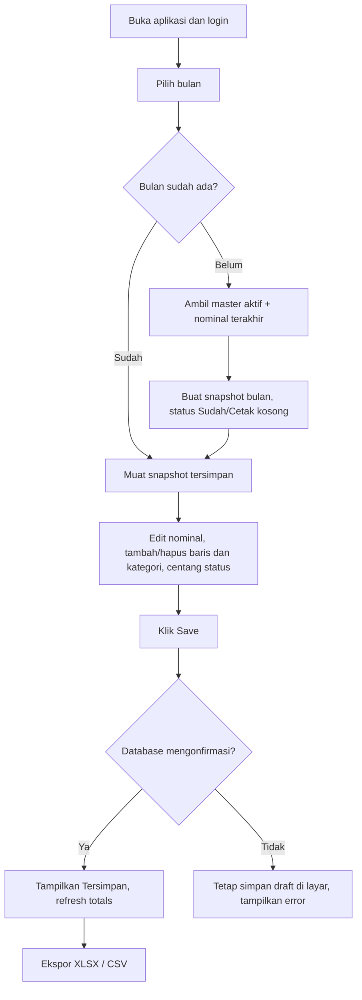

# PRD v1.0 — Aplikasi Pembukuan Tagihan Bulanan Sekolahan

**Tanggal:** 24 Oktober 2026  
**Status:** v3.0. Source web disiapkan dan 2.440 baris dari file Numbers asli telah diimpor ke Drive privat. Save live masih menunggu pemilik menerbitkan Apps Script dan mengatur Vercel environment variables.  
**Platform:** Aplikasi web responsif (PC dan HP)  
**Akses:** 1 pemilik akun (single-user)  
**Mata uang:** IDR  
**Zona waktu:** Asia/Jakarta

## 1. Tujuan
Mengubah file `Tagihan Listrik Sekolahan.numbers` menjadi aplikasi tagihan bulanan dengan data permanen di server, otomatis mengulang daftar pelanggan/tagihan setiap bulan, perubahan nominal dan status per bulan tanpa merusak riwayat, pengaturan baris dan kategori, impor historis 2020–2026, serta ekspor ke Excel, CSV dan format kompatibel Apple Numbers.

**Batasan:** BUKAN aplikasi akuntansi lengkap. Tidak membuat jurnal debit-kredit, neraca, atau laba rugi.

## 2. Rujukan struktur file
Tampilan contoh memperlihatkan kolom `Sudah` (checkbox pembayaran), `Description` (nama + nomor pelanggan), `Tagihan` (rupiah), `Toko` (platform pembayaran), `Cetak` (checkbox sudah mencetak bukti); baris pemisah kategori dan TOTAL. Kategori terlihat antara lain Listrik, Telepon Telkom, PDAM Jakarta/Palyja, PAM Cianjur, IndiHome, dan Listrik Puncak. Nama kategori dan seluruh periode historis perlu diverifikasi dari isi workbook saat tahap impor, bukan hanya dari gambar tampilan.

## 3. Keputusan final dari pengguna
1. Pengelolaan tagihan bulanan saja.
2. `Sudah` = sudah dibayar.
3. `Cetak` = bukti pembayaran sudah dicetak.
4. `Toko` = tempat/platform bayar (Shopee, Tokopedia, DANA, dll.).
5. Bulan baru mewarisi semua tagihan berulang beserta nominal bulan terbaru sebelumnya.
6. Semua riwayat file 2020–2026 harus bisa diimpor.
7. Satu pengguna.
8. Aplikasi web yang nyaman di PC maupun HP.
9. Ada tombol **Save** yang benar-benar menyimpan ke database server.
10. Baris dan kategori bisa ditambahkan, diubah, diurutkan, dan dikurangi.
11. Data bisa diekspor ke spreadsheet, Excel, dan digunakan di Apple Numbers.

## 4. Aturan bisnis (wajib)
### 4.1 Data master tagihan
- Satu entitas master untuk tiap pelanggan/nomor pelanggan/tagihan berulang.
- Field: kategori, nama pelanggan, nomor pelanggan (STRING untuk mempertahankan angka nol di depan), urutan tampilan, aktif/nonaktif, catatan opsional, platform default opsional.
- Master tidak menyimpan status Sudah/Cetak; kedua status berbeda pada setiap bulan.
- Mengarsipkan master berarti tidak ikut ke bulan berikutnya, tanpa menghilangkan catatan masa lalu.
- Pengguna dapat menambah baris baru sebagai (a) hanya bulan yang sedang dibuka, atau (b) berulang mulai bulan ini.

### 4.2 Pembuatan bulan baru
- Buka periode `YYYY-MM` yang belum ada -> server membuat snapshot **tepat satu kali** dari master aktif.
- Nominal default diturunkan dari **bulan terdahulu terbaru yang tersedia** untuk master yang sama, bukan dari total/kategori lain. Jika tagihan baru belum punya riwayat, isi Rp0 dan tandai untuk diisi (jangan dianggap sudah dibayar).
- Platform terakhir boleh menjadi nilai awal, namun bisa diedit pada bulan baru.
- **Status Sudah = FALSE dan Cetak = FALSE** di setiap bulan baru, tanpa pengecualian, walau bulan sebelumnya sudah lunas/tercetak.
- Setelah bulan dibuat, mengubah bulan sebelumnya tidak mengubah nominal bulan berikutnya yang sudah tersimpan.
- Bila sebuah periode dibuka atau refresh berkali-kali, bulan yang sama tidak boleh digandakan (unique constraint pada periode + master ID).
- Perubahan master/kategori di masa depan tidak menghapus atau memindahkan riwayat lama.
- Untuk tagihan berulang yang diarsipkan, tidak muncul di periode setelah tanggal berlaku arsip. Baris historis tetap ada.

### 4.3 Penyimpanan
- Semua edit awal ditandai **Belum Disimpan**.
- Klik tombol `Save` mengirim perubahan sebagai satu transaksi server; tampilkan `Tersimpan [jam]` hanya setelah server mengonfirmasi sukses.
- Tampilkan kegagalan Save secara jelas, perubahan tetap berada di layar untuk dicoba ulang.
- Peringatkan pengguna jika pindah bulan/menutup halaman saat ada perubahan yang belum tersimpan.
- Perubahan tagihan dari dua tab sekaligus tidak boleh saling menimpa diam-diam; gunakan version check/optimistic concurrency.

### 4.4 Status & perhitungan
- `Sudah` dan `Cetak` adalah checkbox terpisah; pada bulan baru keduanya kosong.
- `Tanggal Bayar` (opsional) otomatis terisi ketika ditandai Sudah (waktu Jakarta); saat membatalkan pembayaran, tentukan pembatalan dan jejak perubahan.
- `Total Tagihan` = SUM seluruh nominal aktif di periode itu (bukan hanya yang lunas).
- `Total Dibayar` = SUM yang Sudah dicentang.
- `Sisa/Belum Dibayar` = Total Tagihan − Total Dibayar.
- Semua agregasi dihitung dari data tersimpan server dan ditampilkan ulang saat Save.
- Gunakan decimal/NUMERIC, jangan floating point untuk nominal uang.

### 4.5 Penghapusan
- `Hapus dari bulan ini`: sembunyikan/nonaktifkan baris hanya pada periode aktif.
- `Arsipkan dari bulan depan`: tidak muncul lagi di bulan berikutnya, tetapi histori tetap.
- `Hapus permanen`: hanya untuk baris yang belum memiliki jejak transaksi/histori, dengan konfirmasi khusus. Hindari cascade delete pada histori.
- Untuk kategori, `Hapus` aman jika kategori kosong; bila berisi data, tawarkan pindahkan ke kategori lain atau arsipkan. Jaga riwayat kategori pada tiap snapshot.

## 5. Navigasi dan UI
### 5.1 Sidebar desktop / menu mobile
- Dashboard
- Tagihan Bulanan
- Master Pelanggan/Tagihan
- Kategori
- Riwayat & Laporan
- Impor / Ekspor
- Pengaturan

### 5.2 Halaman Tagihan Bulanan (inti)
Header: `[<] Oktober 2026 [>] [Pilih bulan]` dan tombol `+ Tambah Baris`, `+ Kategori`, `Impor`, `Export`, **Save**.

Tabel per kategori (bisa collapse):
`Sudah | Nama | No. Pelanggan | Tagihan (Rp) | Toko/Platform | Cetak | Aksi`

Footer: `Total Tagihan | Sudah Dibayar | Belum Dibayar | Jumlah Baris`.

- Edit nominal inline tanpa membuka formulir berat.
- Format ribuan rupiah otomatis dan periksa input invalid/negatif.
- Checkbox bisa langsung dipilih; perubahan ditandai Belum Disimpan sampai Save.
- Search by nama, nomor pelanggan; filter kategori, status Sudah, Cetak, platform.
- Urutkan baris/kategori manual; tetap simpan urutan agar mirip layout file asli.
- UI ponsel menggunakan kartu/list per tagihan, bukan memaksa tabel lebar horizontal.
- Highlight status tagihan belum lunas, bukan hanya dibedakan warna (aksesibilitas).

### 5.3 Ringkasan Dashboard
- Pilih bulan
- Total tagihan, total dibayar, sisa, jumlah tagihan lunas/belum lunas
- Ringkasan per kategori
- Riwayat total tagihan bulanan dan perbandingan periode sebelumnya
- Pintasan ke tagihan yang belum dibayar/ belum dicetak

## 6. Impor riwayat 2020–2026
### 6.1 Masukan
- Sumber asli `.numbers` disimpan utuh.
- Implementasi import **langsung `.numbers`** perlu diuji pada file yang diberikan. Format Apple iWork mengandung berkas `.iwa`; jangan mengasumsikan parser berhasil 100%.
- Jalur fallback aman: konversi di Apple Numbers (File > Export To > Excel), lalu impor `.xlsx`. Pengguna tidak kehilangan file asli.

### 6.2 Preview sebelum commit
1. Unggah file / pilih hasil konversi.
2. Deteksi setiap tab/periode/tabel, baris pemisah kategori, subtotal, total rumus, dan checkbox.
3. Pratinjau hasil parsing untuk tiap periode, jumlah baris dan total yang dibandingkan dengan file.
4. Tandai sheet yang periode tidak dapat dikenali, nomor pelanggan ambigu, kategori tidak jelas, duplikasi, nominal invalid, status checkbox tak diketahui.
5. Pengguna mengonfirmasi impor setelah laporan validasi; bila gagal, tidak boleh ada impor separuh yang tidak diketahui.
6. Laporan final: jumlah periode, master unik, baris transaksi, nilai total per periode, duplikat/yang diskip, warning.

**Aturan:** master diidentifikasi menggunakan kategori + nomor pelanggan setelah normalisasi konservatif. Jangan gabungkan nomor pelanggan yang mirip tanpa konfirmasi. Baris total dan judul kategori tidak diimpor sebagai tagihan. Pertahankan nomor pelanggan sebagai string, termasuk nol awal. Simpan jejak sumber file, tab, dan nomor baris untuk audit.

### 6.3 Kontrol impor ulang
- Upsert/idempotent per `source_file_hash + sheet + source_row` atau mapping stabil; impor file yang sama dua kali tidak membuat duplikat.
- Riwayat nominal/status impor yang sudah diverifikasi tidak ditimpa tanpa pilihan eksplisit.

## 7. Ekspor
- `Excel (.xlsx)` sebagai format utama, workbook terdiri dari `Ringkasan`, periode terpilih/semua periode, dan `Master`; sheet menampilkan rumus subtotal bila dibutuhkan, angka tetap numerik, checkbox diterjemahkan ke `Ya/Tidak` atau TRUE/FALSE yang jelas.
- `CSV (.csv)` per periode, UTF-8 BOM kompatibel Excel regional.
- `Apple Numbers`: `.xlsx` dapat dibuka di aplikasi Numbers, lalu disimpan sebagai `.numbers`. Ekspor `.numbers` native dari server **tidak dijanjikan pada v1** kecuali jalur konversi Apple terbukti tersedia dan teruji.
- `Backup keseluruhan`: ekspor .xlsx seluruh histori + JSON terstruktur (opsional pada v1.1), termasuk master, kategori dan metadata.
- Filter ekspor: bulan tunggal, rentang bulan, semua data, per kategori, dan hanya yang belum dibayar.

## 8. Model data (konseptual)

```text
users                 (id, email, password/auth provider)
categories            (id, name, sort_order, active, created_at)
bill_templates        (id, category_id, customer_name, customer_number TEXT,
                       default_platform_id NULL, sort_order, active, starts_at,
                       archived_at, created_at, updated_at)
payment_platforms     (id, name, active)
monthly_periods       (id, period_ym UNIQUE, status, generated_at, updated_at, version)
monthly_bills         (id, monthly_period_id, bill_template_id NULL,
                       category_name_snapshot, customer_name_snapshot,
                       customer_number_snapshot, amount NUMERIC(18,2),
                       platform_name_snapshot, is_paid BOOL DEFAULT FALSE,
                       paid_at NULL, is_printed BOOL DEFAULT FALSE,
                       printed_at NULL, is_recurring BOOL, sort_order,
                       hidden_at NULL, notes, row_version,
                       imported_source_id NULL)
import_batches        (id, file_name, sha256, uploaded_at, status, totals_json,
                       warnings_json)
import_row_sources    (id, batch_id, source_sheet, source_row, monthly_bill_id,
                       raw_values_json)
audit_events          (id, record_type, record_id, action, before_json,
                       after_json, created_at)
```

**Constraint utama:** `UNIQUE(monthly_period_id, bill_template_id)` untuk baris template yang tidak NULL; bila one-off, beri ID baris unik. Gunakan upsert transaksi untuk pembuatan bulan. Index `(period_ym)` dan `(monthly_period_id, sort_order)`.

## 9. API (gambaran kontrak)
- `GET /api/periods` — daftar periode
- `POST /api/periods/:ym/initialize` — buat snapshot bulan secara idempotent
- `GET /api/periods/:ym/bills` — fetch semua row + totals
- `PUT /api/periods/:ym/bills` — bulk Save atomik; payload rows dan versi snapshot
- `POST /api/templates` / `PATCH /api/templates/:id` — tambah/ubah master
- `POST /api/templates/:id/archive` — hentikan berulang
- `GET/POST/PATCH /api/categories` — konfigurasi kategori
- `POST /api/imports/preview` — parsing + laporan preview tanpa menyimpan transaksi
- `POST /api/imports/commit` — impor yang sudah dikonfirmasi
- `GET /api/exports?format=xlsx|csv&period=...` — ekspor

Auth wajib untuk setiap API, ditambah pembatasan akses data secara server-side.

## 10. Arsitektur rekomendasi
- Frontend + API: Next.js (TypeScript) + Tailwind CSS.
- Database untuk tahap personal: file JSON privat di Google Drive, diakses hanya oleh Apps Script atas izin pemilik. Gunakan database PostgreSQL bila skala atau jumlah editor meningkat.
- Login: satu akun, autentikasi aman; RLS atau enforcement owner pada server.
- Hosting: Vercel untuk aplikasi web.
- Storage: Google Drive pribadi dengan JSON sumber, backup Numbers asli, XLSX, CSV, dan laporan audit. Jangan publikasikan URL file pribadi.
- Backup: ekspor manual dan file backup Drive; jadwal backup otomatis merupakan peningkatan berikutnya.
- Deploy staging sebelum production; environment variables untuk seluruh rahasia, validasi input server-side, HTTPS.

## 11. Alur inti


## 12. Prioritas implementasi
**Fase A — Fondasi:** auth satu akun, database, kategori, master, snapshot bulan baru, tabel editable, Save atomik, totals.

**Fase B — Migrasi:** importer dengan preview dan error report, rekonsiliasi semua tab 2020–2026, deduplication, preservasi historis.

**Fase C — Ekspor & polish:** Excel/CSV, dashboard per kategori, mobile responsive, search/filter, arsip row/kategori, backup dan audit.

**Fase berikutnya (opsional):** upload bukti pembayaran, PDF/print, pengingat jatuh tempo, backup otomatis ke Google Drive, ekspor native `.numbers` via converter yang teruji.

## 13. Acceptance criteria (definition of done)
1. Buka November 2026 pertama kali menghasilkan daftar aktif dengan nominal tersalin dari Oktober 2026, **tanpa status lunas/cetak**.
2. Refresh November tidak menciptakan duplikat.
3. Edit November tidak mengubah Oktober ataupun riwayat 2020–2026.
4. Klik Save → reload browser → data tetap sama karena berasal dari server.
5. Save gagal → ada pesan gagal, draft masih dapat diperbaiki dan di-save lagi.
6. Tambah baris berulang → muncul di bulan berikutnya; baris khusus bulan ini tidak muncul lagi.
7. Arsip master tidak menghapus tagihan dan bukti riwayat.
8. Jumlah tagihan / lunas / tersisa akurat sampai rupiah.
9. Ekspor `.xlsx` bisa dibuka Excel dan Numbers tanpa hilang nomor pelanggan nol depan.
10. Semua sheet historis yang dikenali memiliki total terimpor yang cocok dengan hasil normalisasi sumber; ketidaksesuaian ditampilkan dan diselesaikan sebelum migrasi final.
11. Tampilan PC dan HP dapat mengedit, memberi checkbox, menambah row, Save, dan Export.
12. Fitur impor ulang tidak membuat tagihan ganda.

## 14. Risiko & mitigasi
- Format Numbers tidak mudah diekstraksi → parser diuji pada file nyata; fallback ekspor ke XLSX sebelum migrasi.
- Nomor pelanggan dengan nol di depan → `TEXT`, bukan numeric.
- Baris kategori dan total bisa keliru masuk sebagai pelanggan → deteksi jenis baris dan preview import.
- Salin status bulan lalu berbahaya → reset semua status bulanan menjadi belum dibayar/belum dicetak.
- Edit dan refresh sebelum Save → indikator draft + proteksi navigasi.
- Akses server tanpa keamanan → authentication, authorization dan backup.
- Menghapus master merusak histori → soft archive dan snapshot denormalized.

## 15. Keputusan default untuk hal yang belum disebut
- Nominal kosong pada master baru = Rp0, tampilkan badge `Perlu diisi` agar tidak salah dianggap sudah ditagih.
- Platform pembayaran disalin dari penggunaan terakhir bila tersedia dan tetap bisa diubah.
- Pembayaran sebagian / cicilan **tidak termasuk v1**; checkbox `Sudah` hanya berarti lunas.
- Baris lain-lain sekali bayar didukung sebagai one-off.
- Data lama tetap editable dengan konfirmasi agar koreksi mungkin tetapi tidak tanpa sengaja.
- Tidak ada autosave tersembunyi; **Save manual adalah sumber kebenaran**.

---
**Catatan tahap kerja:** Implementasi web sudah dibangun. Impor file asli ke Google Drive privat selesai. Fitur Save live **belum diaktifkan** sebelum konfigurasi Google Apps Script oleh pemilik dan uji penyimpanan sukses. Lihat `docs/IMPORT_REPORT.md`.
